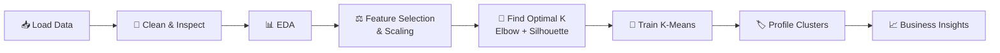
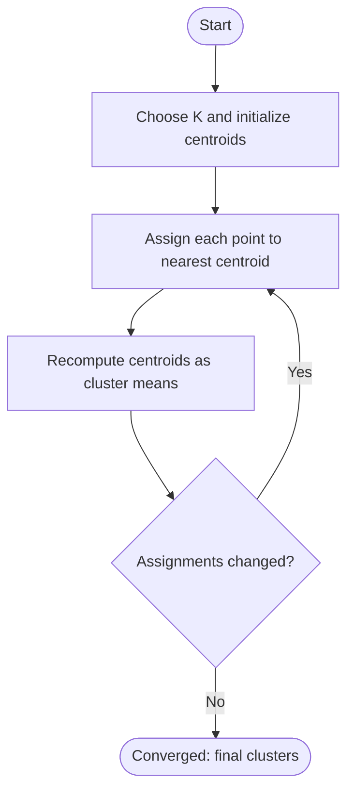

<!-- ===================== ANIMATED HEADER ===================== -->
<div align="center">


<a href="https://git.io/typing-svg">
  
</a>

<br/>


</div>

---

## 📑 Table of Contents

- [Project Summary](#-project-summary)
- [Problem Statement](#-problem-statement)
- [Objectives](#-objectives)
- [Dataset Description](#-dataset-description)
- [Project Structure](#-project-structure)
- [Tech Stack](#-tech-stack)
- [Project Workflow](#-project-workflow)
- [Detailed Methodology](#-detailed-methodology)
- [How K-Means Works](#-how-k-means-works)
- [Customer Segments](#-customer-segments)
- [Marketing Strategy per Segment](#-marketing-strategy-per-segment)
- [Key Insights](#-key-insights)
- [Limitations](#-limitations)
- [Getting Started](#-getting-started)
- [Future Improvements](#-future-improvements)
- [Contributing](#-contributing)
- [Author](#-author)

---

## 🔍 Project Summary

Shopping malls collect a lot of customer information, but raw rows of numbers don't tell a marketing team what to do. This project uses **unsupervised machine learning** to divide mall customers into **groups with similar income and spending behavior**, so each group can be targeted with the right offers, campaigns and loyalty programs.

Because there is no "correct answer" column in the data (no pre-defined labels), this is a **clustering** problem rather than a classification problem. The algorithm discovers the structure on its own, and the analyst then interprets what each discovered group means for the business.

| | |
|---|---|
| **Type of problem** | Unsupervised learning, clustering |
| **Main algorithm** | K-Means |
| **Domain** | Retail analytics, customer segmentation |
| **Input** | Customer demographics and spending score |
| **Output** | Customer segments (cluster labels) with business personas |

---

## ❓ Problem Statement

A mall's marketing team has limited budget and a diverse set of visitors. Sending the same promotion to everyone is wasteful: a student with a small income and a high-earning professional do not respond to the same offer.

> **Question this project answers:** *Which groups of customers exist in our data, how do they differ, and how should we market to each of them?*

---

## 🎯 Objectives

1. **Explore** the customer dataset and understand its distributions and relationships.
2. **Identify** the features that best separate customers (annual income and spending score).
3. **Determine** the optimal number of clusters using quantitative methods (Elbow method and Silhouette score).
4. **Cluster** the customers using K-Means.
5. **Profile** every cluster by its average age, income, spending score and gender mix.
6. **Translate** the clusters into practical, segment-specific marketing recommendations.

---

## 🗂️ Dataset Description

The project uses the **Mall Customers** dataset, which contains information about **200 customers** who hold a membership card at a mall.

| Column | Type | Description |
|--------|------|-------------|
| `CustomerID` | Integer | Unique identifier for each customer (not used for modelling) |
| `Gender` / `Genre` | Categorical | Male or Female |
| `Age` | Integer | Age of the customer in years |
| `Annual Income (k$)` | Integer | Yearly income in thousands of dollars |
| `Spending Score (1-100)` | Integer | Score assigned by the mall based on customer behavior and spending pattern (higher means a bigger spender) |

**Dataset characteristics**

- 200 rows and 5 columns
- No missing values in the standard version of the dataset
- Small, clean and well suited for learning clustering
- `Spending Score` is a mall-defined metric, so it already captures behavior instead of raw transaction totals

> 📌 The data is stored in the [`Data/`](Data) folder. Column names can differ slightly between CSV versions.

---

## 📁 Project Structure

```text
Mall-Customer-Segmentation/
│
├── 📂 Data/              # Mall customers dataset (CSV)
├── 📂 Notebook/          # Jupyter notebook: EDA, clustering and interpretation
├── 📄 requirements.txt   # Python dependencies
└── 📘 README.md          # Project documentation
```

---

## 🧰 Tech Stack

| Library | Purpose |
|---------|---------|
|  | Loading, cleaning and grouping data |
|  | Numerical operations |
|  | Base plotting |
|  | Statistical visualizations (distributions, pair plots, heatmaps) |
|  | K-Means, feature scaling, silhouette score |
|  | Scientific utilities, e.g. hierarchical clustering and dendrograms |

---

## 🔄 Project Workflow



---

## 🧪 Detailed Methodology

### Step 1: Data Loading and Inspection

Load the CSV with pandas and check the basics before any modelling.

```python
import pandas as pd

df = pd.read_csv("Data/Mall_Customers.csv")   # adjust to your file name
df.head()
df.info()
df.describe()
df.isnull().sum()
df.duplicated().sum()
```

What is checked: shape, data types, missing values, duplicates, and summary statistics (mean, min, max, quartiles).

### Step 2: Exploratory Data Analysis (EDA)

EDA builds intuition about the customers before clustering.

| Analysis | Plot used | What it reveals |
|----------|-----------|-----------------|
| Gender distribution | Count plot / pie chart | Balance between male and female customers |
| Age distribution | Histogram / KDE | Which age groups visit most |
| Income distribution | Histogram / KDE | Spread of customer purchasing power |
| Spending score distribution | Histogram / KDE | How many low, medium and high spenders exist |
| Feature relationships | Pair plot, scatter plot | Visible groupings between income and spending |
| Correlations | Heatmap | Linear relationships between numeric features |
| Gender vs spending | Box / violin plot | Whether gender affects spending behavior |

A scatter plot of **Annual Income vs Spending Score** is the key visual: it shows distinct dense regions, which is a strong sign that clustering will work well.

### Step 3: Feature Selection and Scaling

- `CustomerID` is dropped because it is only an identifier and carries no behavioral meaning.
- **Annual Income** and **Spending Score** are the primary clustering features because they directly describe purchasing power and behavior.
- `Age` (and optionally encoded `Gender`) can be added to test multi-dimensional segments.
- K-Means is **distance-based**, so features on different scales can dominate the result. Scaling puts them on equal footing.

```python
from sklearn.preprocessing import StandardScaler

X = df[["Annual Income (k$)", "Spending Score (1-100)"]]
X_scaled = StandardScaler().fit_transform(X)
```

### Step 4: Choosing the Number of Clusters (K)

K-Means requires the number of clusters in advance, so two complementary methods are used.

**a) Elbow method.** Plot WCSS (within-cluster sum of squares, also called inertia) for K = 1 to 10. WCSS always drops as K grows, but the rate of improvement slows sharply at the "elbow". That point is a good K.

```python
from sklearn.cluster import KMeans
import matplotlib.pyplot as plt

wcss = []
for k in range(1, 11):
    km = KMeans(n_clusters=k, init="k-means++", n_init=10, random_state=42)
    km.fit(X)
    wcss.append(km.inertia_)

plt.plot(range(1, 11), wcss, marker="o")
plt.xlabel("Number of clusters (K)")
plt.ylabel("WCSS")
plt.title("Elbow Method")
plt.show()
```

**b) Silhouette score.** Measures how similar a point is to its own cluster compared with other clusters. Values range from -1 to 1, and higher is better.

| Silhouette value | Interpretation |
|:----------------:|----------------|
| Close to 1 | Well separated, compact clusters |
| Around 0 | Overlapping clusters |
| Negative | Points likely assigned to the wrong cluster |

```python
from sklearn.metrics import silhouette_score

for k in range(2, 11):
    labels = KMeans(n_clusters=k, n_init=10, random_state=42).fit_predict(X)
    print(f"K={k}  silhouette={silhouette_score(X, labels):.3f}")
```

### Step 5: Model Training

```python
kmeans = KMeans(n_clusters=5, init="k-means++", n_init=10, random_state=42)
df["Cluster"] = kmeans.fit_predict(X)
centroids = kmeans.cluster_centers_
```

- `init="k-means++"` spreads initial centroids apart, giving faster and more stable convergence than purely random starts.
- `n_init=10` runs the algorithm 10 times with different starting points and keeps the best result.
- `random_state=42` makes results reproducible.

### Step 6: Visualizing the Clusters

```python
import seaborn as sns

plt.figure(figsize=(9, 6))
sns.scatterplot(
    data=df, x="Annual Income (k$)", y="Spending Score (1-100)",
    hue="Cluster", palette="tab10", s=70
)
plt.scatter(centroids[:, 0], centroids[:, 1], c="black", s=250, marker="*", label="Centroids")
plt.title("Customer Segments")
plt.legend()
plt.show()
```

### Step 7: Cluster Profiling

Numbers become insight only when each cluster is described in plain language.

```python
profile = df.groupby("Cluster").agg(
    customers=("CustomerID", "count"),
    avg_age=("Age", "mean"),
    avg_income=("Annual Income (k$)", "mean"),
    avg_spending=("Spending Score (1-100)", "mean"),
).round(1)
print(profile)
```

Also check the gender mix per cluster, e.g. `pd.crosstab(df["Cluster"], df["Gender"], normalize="index")`.

---

## 🧠 How K-Means Works

K-Means partitions the data into **K** groups by repeating two steps until the groups stop changing.

1. **Initialize:** pick K starting centroids (K-Means++ spreads them out smartly).
2. **Assign:** give every customer to the nearest centroid, using Euclidean distance.
3. **Update:** move each centroid to the mean position of the customers assigned to it.
4. **Repeat** steps 2 and 3 until assignments no longer change (convergence).

The objective it minimizes is the within-cluster sum of squares:

```text
WCSS = Σₖ Σ(x ∈ Cₖ) ‖x − μₖ‖²
```

where `Cₖ` is cluster k and `μₖ` is its centroid.



**Strengths:** simple, fast, scales well, easy to interpret.
**Weaknesses:** K must be chosen up front, it assumes roughly round clusters of similar size, and it is sensitive to outliers and initialization.

---

## 👥 Customer Segments

On the Income vs Spending Score plane this dataset typically separates into **five** groups. Confirm the exact figures against your own notebook output.

| Segment | Income | Spending | Persona |
|---------|:------:|:--------:|---------|
| 🏆 **Target / VIP** | High | High | Affluent, engaged shoppers |
| 💎 **Careful / Untapped** | High | Low | Wealthy but rarely spend; biggest growth opportunity |
| 🛍️ **Impulsive Spenders** | Low | High | Spend freely despite modest income |
| ⚖️ **Standard** | Medium | Medium | Balanced, average shoppers |
| 🪙 **Budget-conscious** | Low | Low | Price-sensitive, low engagement |

> ✏️ Replace these names and values with the labels and profile numbers from your own analysis.

---

## 📈 Marketing Strategy per Segment

| Segment | Recommended Action | Goal |
|---------|--------------------|------|
| 🏆 Target / VIP | Loyalty tiers, early access to sales, premium experiences | Retain and grow lifetime value |
| 💎 Careful / Untapped | Personalized premium offers, targeted campaigns, exclusive previews | Convert high income into spending |
| 🛍️ Impulsive Spenders | Flash sales, bundles, limited-time deals, in-mall events | Sustain engagement without over-discounting |
| ⚖️ Standard | Seasonal promotions, upselling, referral programs | Nudge toward higher spending |
| 🪙 Budget-conscious | Discount coupons, clearance events, value-focused messaging | Keep them active at low cost |

---

## 💡 Key Insights

- Income and spending score together separate customers far better than either feature alone.
- High income does **not** guarantee high spending, so the "High income / Low spending" group is a clear opportunity for targeted campaigns.
- Spending behavior is distinct from earning power, which is why behavior-based segmentation beats simple income brackets.
- Clear segment profiles let marketing, pricing and loyalty teams act on data instead of guesses.

> ✏️ Add the specific findings from your notebook here (cluster sizes, age ranges per segment, gender differences, silhouette score of the final model).

---

## ⚠️ Limitations

- **Small dataset:** only 200 customers, so findings may not generalize to a whole mall.
- **Few features:** no purchase history, product categories, visit frequency or time-based behavior.
- **Spending Score is a derived metric:** its exact calculation is defined by the mall, not by raw transactions.
- **K-Means assumptions:** it works best with spherical, similarly sized clusters and is sensitive to outliers.
- **Static snapshot:** customer behavior changes over time, so segments should be refreshed regularly.

---

## 🚀 Getting Started

### Prerequisites

- Python 3.8 or higher
- pip
- Jupyter Notebook or JupyterLab

### Installation

```bash
# 1. Clone the repository
git clone https://github.com/TrivediMan/Mall-Customer-Segmentation.git
cd Mall-Customer-Segmentation

# 2. (Recommended) create a virtual environment
python -m venv venv
source venv/bin/activate        # Windows: venv\Scripts\activate

# 3. Install dependencies
pip install -r requirements.txt

# 4. Launch Jupyter
jupyter notebook
```

Open the notebook inside the [`Notebook/`](Notebook) folder and run all cells (**Kernel → Restart & Run All**).

---

## 🔮 Future Improvements

- [ ] Compare K-Means with **Hierarchical clustering** (dendrogram), **DBSCAN** and **Gaussian Mixture Models**
- [ ] Add **3D clustering** using Age + Income + Spending Score
- [ ] Apply **PCA** for dimensionality reduction and visualization
- [ ] Build an interactive **Streamlit** dashboard to explore segments
- [ ] Train a classifier to predict the segment of a new customer
- [ ] Validate segments on a larger, real transaction dataset

---

## 🤝 Contributing

Contributions are welcome.

1. Fork the repo
2. Create a branch: `git checkout -b feature/your-idea`
3. Commit your changes: `git commit -m "Add your idea"`
4. Push: `git push origin feature/your-idea`
5. Open a Pull Request

---

## 👤 Author

<div align="center">

**Man Trivedi**

[](https://github.com/TrivediMan)

If you found this project useful, please consider giving it a ⭐

</div>


