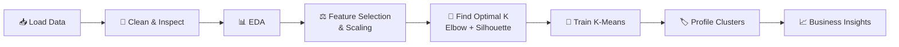

<!-- ===================== ANIMATED HEADER ===================== -->
<div align="center">


<a href="https://git.io/typing-svg">
  
</a>

<br/>


</div>
---

## 📑 Table of Contents

- [Overview](#-overview)
- [Business Problem](#-business-problem)
- [Dataset](#-dataset)
- [Project Structure](#-project-structure)
- [Tech Stack](#-tech-stack)
- [Methodology](#-methodology)
- [Customer Segments](#-customer-segments)
- [Marketing Strategy per Segment](#-marketing-strategy-per-segment)
- [Getting Started](#-getting-started)
- [Generate the Animation](#-generate-the-animation)
- [Future Improvements](#-future-improvements)
- [Contributing](#-contributing)
- [Author](#-author)

---

## 🔍 Overview

Shopping malls collect a lot of information about their customers, but raw rows of numbers do not tell a marketing team what to do. This project applies **unsupervised machine learning** to group mall customers into **segments with similar behavior**, so each group can be targeted with the right offers, campaigns and loyalty programs.

**What this project does**

- 🧹 Loads and explores the customer dataset (EDA)
- 📊 Visualizes distributions of age, income, spending and gender
- 🧠 Applies **clustering** to discover natural customer groups
- 📐 Selects the optimal number of clusters (Elbow method / Silhouette score)
- 🏷️ Interprets each cluster as an actionable customer persona

---

## 🎯 Business Problem

> *"Which customers should we focus on, and how should we talk to each of them?"*

A one-size-fits-all promotion wastes budget. Segmentation lets the business:

| Goal | How segmentation helps |
|------|------------------------|
| 💰 Increase revenue | Identify and retain high-spending customers |
| 🎁 Personalize offers | Send relevant deals to each group |
| 📉 Reduce marketing cost | Stop over-targeting low-engagement groups |
| 🔄 Improve retention | Re-engage customers with high income but low spending |

---

## 🗂️ Dataset

The project uses the **Mall Customers** dataset (200 customers).

| Column | Description |
|--------|-------------|
| `CustomerID` | Unique customer identifier |
| `Gender` / `Genre` | Male / Female |
| `Age` | Customer age in years |
| `Annual Income (k$)` | Annual income in thousands of dollars |
| `Spending Score (1-100)` | Score assigned by the mall based on behavior and spending nature |

> 📌 The dataset lives in the [`Data/`](Data) folder. Column names may differ slightly depending on the CSV version.

---

## 📁 Project Structure

```text
Mall-Customer-Segmentation/
│
├── 📂 Data/                  # Mall customers dataset (CSV)
├── 📂 Notebook/              # Jupyter notebook with EDA + clustering
├── 📂 assets/                # Images and animated GIFs used in this README
│   └── kmeans_animation.gif
├── 🐍 make_animation.py      # Script that generates the K-Means GIF
├── 📄 requirements.txt       # Python dependencies
└── 📘 README.md              # You are here
```

---

## 🧰 Tech Stack

| Library | Purpose |
|---------|---------|
|  | Data loading and manipulation |
|  | Numerical computing |
|  | Plotting and animation |
|  | Statistical visualization |
|  | K-Means, scaling, silhouette score |
|  | Scientific utilities (e.g. hierarchical clustering / dendrograms) |

---

## 🧪 Methodology



### 1. Data Understanding & Cleaning
Check shape, data types, missing values and duplicates. Summarize with `describe()`.

### 2. Exploratory Data Analysis
- Gender split of customers
- Age, income and spending-score distributions
- Relationships between income, age and spending (scatter plots, pair plots, correlation heatmap)

### 3. Feature Selection & Scaling
Clustering is distance-based, so features are chosen carefully and, where needed, standardized with `StandardScaler`.

```python
from sklearn.preprocessing import StandardScaler

X = df[["Annual Income (k$)", "Spending Score (1-100)"]]
X_scaled = StandardScaler().fit_transform(X)
```

### 4. Choosing the Number of Clusters (K)

**Elbow method:** plot inertia (WCSS) for K = 1…10 and look for the "elbow".

```python
from sklearn.cluster import KMeans
import matplotlib.pyplot as plt

wcss = []
for k in range(1, 11):
    km = KMeans(n_clusters=k, init="k-means++", n_init=10, random_state=42)
    km.fit(X)
    wcss.append(km.inertia_)

plt.plot(range(1, 11), wcss, marker="o")
plt.xlabel("Number of clusters (K)")
plt.ylabel("WCSS")
plt.title("Elbow Method")
plt.show()
```

**Silhouette score:** confirm the choice by measuring how well-separated the clusters are.

```python
from sklearn.metrics import silhouette_score

for k in range(2, 11):
    labels = KMeans(n_clusters=k, n_init=10, random_state=42).fit_predict(X)
    print(k, round(silhouette_score(X, labels), 3))
```

### 5. Model Training

```python
kmeans = KMeans(n_clusters=5, init="k-means++", n_init=10, random_state=42)
df["Cluster"] = kmeans.fit_predict(X)
```

### 6. Cluster Profiling

```python
df.groupby("Cluster")[["Age", "Annual Income (k$)", "Spending Score (1-100)"]].mean().round(1)
```

---

## 👥 Customer Segments

On the Income vs. Spending Score plane this dataset typically separates into **five** groups. Confirm the exact numbers against your own notebook output.

| Segment | Income | Spending | Persona |
|---------|:------:|:--------:|---------|
| 🏆 **Target / VIP** | High | High | Affluent, engaged shoppers |
| 💎 **Careful / Untapped** | High | Low | Wealthy but rarely spend: biggest growth opportunity |
| 🛍️ **Impulsive / Spenders** | Low | High | Spend freely despite modest income |
| ⚖️ **Standard** | Medium | Medium | Balanced, average shoppers |
| 🪙 **Budget-conscious** | Low | Low | Price-sensitive, low engagement |

> ✏️ Replace the segment names with the labels from your own cluster analysis.

---

## 📈 Marketing Strategy per Segment

| Segment | Recommended Action |
|---------|--------------------|
| 🏆 Target / VIP | Loyalty tiers, early access to sales, premium experiences |
| 💎 Careful / Untapped | Personalized premium offers, targeted campaigns to raise engagement |
| 🛍️ Impulsive / Spenders | Flash sales, bundles, limited-time deals, "buy now" nudges |
| ⚖️ Standard | Seasonal promotions, upselling, referral programs |
| 🪙 Budget-conscious | Discount coupons, clearance events, value-focused messaging |

---

## 🚀 Getting Started

### Prerequisites
- Python 3.8+
- pip
- Jupyter Notebook or JupyterLab

### Installation

```bash
# 1. Clone the repository
git clone https://github.com/TrivediMan/Mall-Customer-Segmentation.git
cd Mall-Customer-Segmentation

# 2. (Recommended) create a virtual environment
python -m venv venv
source venv/bin/activate        # Windows: venv\Scripts\activate

# 3. Install dependencies
pip install -r requirements.txt

# 4. Launch Jupyter
jupyter notebook
```

Then open the notebook inside the [`Notebook/`](Notebook) folder and run all cells (**Kernel → Restart & Run All**).

---

## 🎞️ Generate the Animation

The animated GIF at the top of this README is created from the actual dataset.

```bash
pip install pillow
python make_animation.py
```

This produces `assets/kmeans_animation.gif`. Commit the `assets/` folder so the GIF shows on GitHub.

Tweak these variables at the top of `make_animation.py` to customize it:

| Variable | Meaning |
|----------|---------|
| `DATA_PATH` | Path to your CSV (default `Data/Mall_Customers.csv`) |
| `K` | Number of clusters |
| `COLORS` | Cluster colors |
| `SEED` | Random seed for reproducible centroid starts |

---

## 🔮 Future Improvements

- [ ] Compare K-Means with **Hierarchical clustering** (dendrogram), **DBSCAN** and **Gaussian Mixture Models**
- [ ] Add **3D clustering** using Age + Income + Spending Score
- [ ] Build an interactive **Streamlit** dashboard to explore segments
- [ ] Add **PCA** for dimensionality reduction and visualization
- [ ] Predict the segment of a new customer with a classifier
- [ ] Deploy the app online

---

## 🤝 Contributing

Contributions are welcome!

1. Fork the repo
2. Create a branch: `git checkout -b feature/amazing-idea`
3. Commit your changes: `git commit -m "Add amazing idea"`
4. Push: `git push origin feature/amazing-idea`
5. Open a Pull Request

---

## 👤 Author

<div align="center">

**Man Trivedi**

[](https://github.com/TrivediMan)

If you found this project useful, please consider giving it a ⭐

</div>


